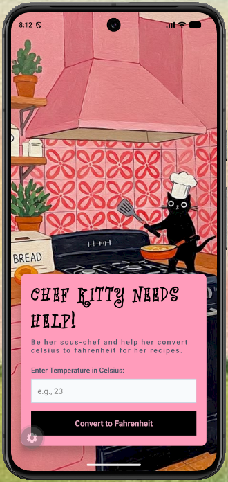
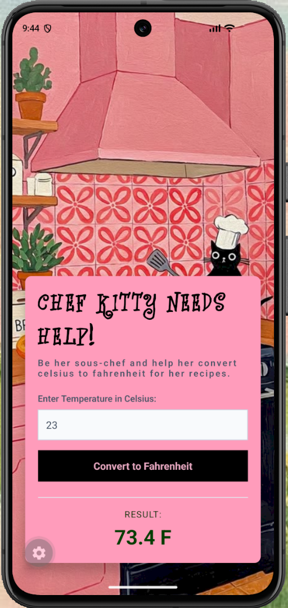

# Kitty's Temperature Converter ˗ˏˋ 🧁 ˎˊ˗

A cozy, kitchen-themed Celsius to Fahrenheit temperature converter built with React Native and Expo.

It's so annoying finding a recipe I really want to make, only to realize all the temperatures are in Celsius when my oven only goes by Fahrenheit. Inspired by that struggle, pink kitchens, and a tiny black cat in a chef's hat, I made a simple temperature converter that feels way more fun to use. 

It lets you be Chef Kitty's sous-chef and quickly convert her recipes without stopping to search it up every time.

## Features

* **Instant Temperature Conversion:** Real-time Celsius (`°C`) to Fahrenheit (`°F`) calculations powered by Redux Toolkit so Chef Kitty never misses a step in her recipes.
* **Input Validation:** Built-in error handling that catches empty fields or non-numeric entries and alerts the user clearly before converting.
* **Keyboard-Friendly Layout:** Integrated `KeyboardAvoidingView` and tap-to-dismiss gestures so the on-screen keyboard smoothly lifts the recipe card without covering the input or illustration.
* **Custom Typography:** Loaded via `expo-font` to give the title a whimsical, hand-lettered cookbook feel.

## Screenshots

| Default Kitchen Screen | Conversion Result |
| :---: | :---: |
|  |  |

## Design Colour Palette Reference

The colours were picked to match the background kitchen artwork:

* **`#ff9cbb` (Pink):** Main card container.
* **`#0b0b0b` / `#000000` (Black):** Header text and convert button.
* **`#ff89b6` (Light Pink):** Button text.
* **`#f8fafc` (Off-White):** Input field background.
* **`#0e3d00` (Dark Green):** Converted Fahrenheit result text.

## Tech Stack and Dependencies

* **Framework:** React Native (Expo Workflow)
* **State Management:** Redux Toolkit & React-Redux (`temperatureSlice`)
* **Typography:** `expo-font` loading custom decorative typography (`Angelica`)
* **Styling:** Native `StyleSheet` API using Flexbox and `ImageBackground` layouts

